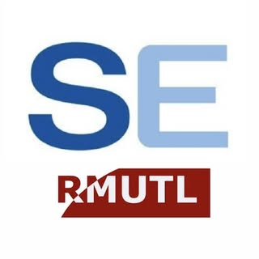

# ENGSE601 — การตรวจสอบความสมเหตุสมผลและการทวนสอบซอฟต์แวร์

<p align="center">
  
</p>

> **Software Validation and Verification · 3(3-0-6)**  
> หลักสูตรวิศวกรรมศาสตรบัณฑิต สาขาวิชาวิศวกรรมซอฟต์แวร์  
> ชั้นปีที่ 3 · ปีการศึกษา 2569 · มหาวิทยาลัยเทคโนโลยีราชมงคลล้านนา

## ภาพรวมรายวิชา

ENGSE601 พัฒนานักศึกษาให้เปลี่ยน “ความต้องการของระบบ” ไปเป็น “หลักฐานเชิงคุณภาพ” ที่ตรวจสอบได้ว่าโปรแกรมทำงานถูกต้อง ตรงตามข้อกำหนด และพร้อมใช้งานจริง โดยเชื่อมการเรียนกับ **ENGSE212 Senior Project in Software Engineering** ตามแนวคิด

> **One Project, Multiple Evidence**  
> โครงงานเดียว สร้างทั้งระบบและหลักฐาน V&V ที่ใช้ได้จริง

รายวิชานี้เป็น 3(3-0-6) ไม่มีชั่วโมงปฏิบัติแยกต่างหาก แต่ใช้ **In-class Workshop**, การอภิปรายกรณีศึกษา, peer review และการทำชิ้นงานจากบริบท Senior Project เพื่อสร้าง **V&V Evidence Portfolio** ตลอดภาคเรียน

---

## เริ่มต้นใช้งาน

1. อ่าน [แนวทางรายวิชาและการส่งงาน](docs/course-guide.md)
2. ตรวจสอบ [CLO / PLO / การประเมินผล](docs/clo-plo-assessment.md)
3. เปิด [กติกาการใช้ AI อย่างรับผิดชอบ](docs/responsible-ai.md)
4. เข้าโฟลเดอร์ของสัปดาห์ปัจจุบันใน [`weeks/`](weeks/)
5. ใช้ [Templates สำหรับชิ้นงาน](templates/)
6. เชื่อมผลงานของทีมกับ **ENGSE212 Student Project Repository**

---

## Course Learning Outcomes (CLOs)

| CLO | นักศึกษาสามารถ… |
|---|---|
| **CLO1** | อธิบายหลักการ software quality, testing, verification, validation และแบบจำลองกระบวนการทดสอบได้ |
| **CLO2** | วิเคราะห์ requirements, acceptance criteria, ความเสี่ยง และสร้าง Requirement Review Sheet / Traceability Matrix ได้ |
| **CLO3** | ออกแบบ test strategy, test cases, test data และแนวทางทดสอบในระดับ component, integration, system, UAT และ NFR ได้ |
| **CLO4** | จัดทำ Test Plan ที่มีขอบเขต กลยุทธ์ ความเสี่ยง บทบาท เครื่องมือ และเกณฑ์ติดตามควบคุมได้ |
| **CLO5** | วิเคราะห์ defect, ติดตามผล สรุปผลการทดสอบ และสื่อสารหลักฐาน V&V ได้ |
| **CLO6** | ทำงานร่วมกัน ใช้ AI อย่างรับผิดชอบ ตรวจสอบผลลัพธ์ และเปิดเผยการใช้ AI ได้ |

---

## แผนการเรียนและ Workshop รายสัปดาห์

> คลิกชื่อหัวข้อเพื่อเปิดรายละเอียดสัปดาห์ กิจกรรม สื่อ ลิงก์สำหรับ PowerPoint/PDF/Canva และชิ้นงานที่ต้องส่ง

| สัปดาห์ | บทเรียน / หัวข้อ | หน่วย | Workshop / กิจกรรม | ชิ้นงานหลัก |
|---:|---|---|---|---|
| 1 | [พื้นฐาน V&V และคุณภาพซอฟต์แวร์](weeks/week-01-foundation-vv-quality/README.md) | หน่วย 1 / บทเรียน 1.1 | Think–Pair–Share + Card Sorting | Quality & V&V Concept Map |
| 2 | [กระบวนการและแบบจำลองการทดสอบ](weeks/week-02-test-process-models/README.md) | หน่วย 1 / บทเรียน 1.2 | Case Comparison: STLC / V-Model / Agile-DevOps | Test Process Map |
| 3 | [ความต้องการที่ทดสอบได้และเกณฑ์การยอมรับ](weeks/week-03-testable-requirements/README.md) | หน่วย 2 / บทเรียน 2.1 | Workshop 1: From Requirements to Testable Requirements | Testability Checklist |
| 4 | [Requirement Review และ Traceability](weeks/week-04-requirement-review-traceability/README.md) | หน่วย 2 / บทเรียน 2.2 | Workshop 2: Peer Requirement Review + AI-assisted Ambiguity Scan | Review Sheet + RTM v1 + AI Use Declaration |
| 5 | [Component / Unit Testing](weeks/week-05-component-unit-testing/README.md) | หน่วย 3 / บทเรียน 3.1 | Code & Logic Reading Clinic | Component Test Case Set |
| 6 | [Integration Testing และความเสี่ยงของ API/Interface](weeks/week-06-integration-api-testing/README.md) | หน่วย 3 / บทเรียน 3.2 | Workshop 3: Interface/API Risk Mapping | Integration Test Design |
| 7 | [System Testing และ User Acceptance Testing](weeks/week-07-system-uat-testing/README.md) | หน่วย 3 / บทเรียน 3.3 | Role Play: User Journey & Acceptance Meeting | System/UAT Scenarios |
| 8 | [เทคนิคการออกแบบ Test Case](weeks/week-08-test-design-techniques/README.md) | หน่วย 3 / บทเรียน 3.4 | Test Design Challenge: EP / BVA / Decision Table / State Transition | Test Case Suite v1 |
| 9 | [สอบกลางภาค](weeks/week-09-midterm-assessment/README.md) | การประเมิน CLO1–CLO3 | Midterm Assessment | ผลการประเมินและข้อเสนอแนะรายบุคคล |
| 10 | [Test Data Engineering](weeks/week-10-test-data-engineering/README.md) | หน่วย 4 / บทเรียน 4.1 | Workshop 4: Test Data Design & Validation | Test Data Sheet + Validation Log |
| 11 | [Non-functional Testing](weeks/week-11-non-functional-testing/README.md) | หน่วย 4 / บทเรียน 4.2 | Risk Clinic: Performance / Security / Usability / Compatibility / Reliability | NFR Test Outline |
| 12 | [Review, Tools และ AI-assisted V&V](weeks/week-12-reviews-tools-ai/README.md) | หน่วย 4 / บทเรียน 4.3 | Workshop 5: Review Checklist & Tool/AI Selection | Review Record + Tool Selection Rationale |
| 13 | [Test Planning และ Estimation](weeks/week-13-test-planning-estimation/README.md) | หน่วย 5 / บทเรียน 5.1 | Workshop 6: Test Planning Sprint | Test Plan v1 |
| 14 | [Monitoring, Control และ Defect Management](weeks/week-14-monitoring-defects/README.md) | หน่วย 5 / บทเรียน 5.2 | Simulation: Defect Triage & Test Dashboard | Defect Report + Metric Snapshot |
| 15 | [Problem Analysis และ Test Reporting](weeks/week-15-reporting-stakeholders/README.md) | หน่วย 5 / บทเรียน 5.3 | Peer Feedback: Defect Report Clinic | Test Summary Report Draft |
| 16 | [V&V Evidence Portfolio และการปฏิบัติวิชาชีพ](weeks/week-16-portfolio-showcase/README.md) | หน่วย 6 / บทเรียน 6.1 | Portfolio Showcase + Individual Reflection | V&V Evidence Portfolio + Peer Review + AI Disclosure |
| 17 | [สอบปลายภาค](weeks/week-17-final-assessment/README.md) | การประเมิน CLO3–CLO6 | Final Assessment | ผลการประเมินและแผนพัฒนาต่อเนื่อง |

---

## ลิงก์ตรงไปยัง Workshop / รายละเอียดรายสัปดาห์

- [สัปดาห์ที่ 1: พื้นฐาน V&V และคุณภาพซอฟต์แวร์](weeks/week-01-foundation-vv-quality/README.md) — ทำความเข้าใจ software quality, error, defect, failure และบทบาทของ testing / verification / validation
- [สัปดาห์ที่ 2: กระบวนการและแบบจำลองการทดสอบ](weeks/week-02-test-process-models/README.md) — เปรียบเทียบกระบวนการทดสอบและเชื่อมกิจกรรม V&V กับวงจรชีวิตของโครงงาน
- [สัปดาห์ที่ 3: ความต้องการที่ทดสอบได้และเกณฑ์การยอมรับ](weeks/week-03-testable-requirements/README.md) — แปลง requirements เป็น test conditions และ acceptance criteria พร้อมวิเคราะห์ความกำกวม
- [สัปดาห์ที่ 4: Requirement Review และ Traceability](weeks/week-04-requirement-review-traceability/README.md) — ตรวจทาน requirements แบบเพื่อนช่วยเพื่อน สร้าง requirement review sheet และ traceability matrix
- [สัปดาห์ที่ 5: Component / Unit Testing](weeks/week-05-component-unit-testing/README.md) — ออกแบบกรณีทดสอบระดับส่วนประกอบจากตรรกะ โค้ด หรือพฤติกรรมของโมดูล
- [สัปดาห์ที่ 6: Integration Testing และความเสี่ยงของ API/Interface](weeks/week-06-integration-api-testing/README.md) — วิเคราะห์จุดเชื่อมต่อระหว่างโมดูล บริการ API และข้อมูลระหว่างส่วนประกอบ
- [สัปดาห์ที่ 7: System Testing และ User Acceptance Testing](weeks/week-07-system-uat-testing/README.md) — ออกแบบ scenario การทดสอบระบบและการยอมรับโดยอิงเป้าหมายของผู้ใช้
- [สัปดาห์ที่ 8: เทคนิคการออกแบบ Test Case](weeks/week-08-test-design-techniques/README.md) — เลือกและใช้เทคนิค black-box เพื่อออกแบบกรณีทดสอบอย่างเป็นระบบ
- [สัปดาห์ที่ 9: สอบกลางภาค](weeks/week-09-midterm-assessment/README.md) — ประเมินแนวคิด V&V ความต้องการที่ทดสอบได้ และการออกแบบ test cases
- [สัปดาห์ที่ 10: Test Data Engineering](weeks/week-10-test-data-engineering/README.md) — สร้าง ตรวจสอบ และปกป้องข้อมูลทดสอบ รวมถึงตรวจทานข้อมูลที่ AI ช่วยเสนอ
- [สัปดาห์ที่ 11: Non-functional Testing](weeks/week-11-non-functional-testing/README.md) — แปลง NFR เป็นเกณฑ์วัดและจัดลำดับความเสี่ยงตามบริบทโครงงาน
- [สัปดาห์ที่ 12: Review, Tools และ AI-assisted V&V](weeks/week-12-reviews-tools-ai/README.md) — ใช้ checklist/review technique และเลือกใช้เครื่องมือ/AI โดยมีหลักฐานตรวจสอบ
- [สัปดาห์ที่ 13: Test Planning และ Estimation](weeks/week-13-test-planning-estimation/README.md) — จัดทำ test plan ที่ระบุขอบเขต กลยุทธ์ ความเสี่ยง บทบาท เครื่องมือ และ entry/exit criteria
- [สัปดาห์ที่ 14: Monitoring, Control และ Defect Management](weeks/week-14-monitoring-defects/README.md) — ติดตามความก้าวหน้า จัดการข้อบกพร่อง และอ่านความหมายของ test metrics
- [สัปดาห์ที่ 15: Problem Analysis และ Test Reporting](weeks/week-15-reporting-stakeholders/README.md) — วิเคราะห์ปัญหาและสื่อสารผล V&V ให้เหมาะกับทีมพัฒนาและผู้มีส่วนได้ส่วนเสีย
- [สัปดาห์ที่ 16: V&V Evidence Portfolio และการปฏิบัติวิชาชีพ](weeks/week-16-portfolio-showcase/README.md) — สังเคราะห์หลักฐาน V&V ของโครงงาน นำเสนอ และสะท้อนการเรียนรู้เชิงวิชาชีพ
- [สัปดาห์ที่ 17: สอบปลายภาค](weeks/week-17-final-assessment/README.md) — ประเมินการวางแผน การควบคุม การวิเคราะห์ผล และการใช้หลักฐาน V&V

---

## เส้นทางผลงาน: V&V Evidence Portfolio

นักศึกษาค่อย ๆ สร้างหลักฐานต่อไปนี้ใน repository ของกลุ่ม ENGSE212:

```text
Requirements / User Stories
        ↓
Requirement Review Sheet + Acceptance Criteria
        ↓
Traceability Matrix (RTM)
        ↓
Test Plan + Test Cases + Test Data
        ↓
NFR Test Outline + Review Records
        ↓
Defect Log + Evidence of Retest + Metrics
        ↓
Test Summary Report + AI Use Declaration + Reflection
```

ดูโครงสร้างชิ้นงานทั้งหมดที่ [docs/evidence-portfolio.md](docs/evidence-portfolio.md)

---

## การใช้ AI อย่างรับผิดชอบ

AI ใช้เพื่อ **ช่วยคิด ช่วยตรวจทาน และช่วยสร้างร่าง** ได้ เช่น ค้นหาความกำกวมใน requirement, เสนอ acceptance criteria, สร้างตัวอย่าง test cases หรือช่วยตรวจรูปแบบรายงาน

แต่ต้อง:

- ตรวจสอบผลทุกครั้งกับ requirement / design / source code / ผลทดสอบจริง
- ไม่สร้างผลการทดสอบหรือ defect ที่ไม่ได้เกิดขึ้นจริง
- ไม่อัปโหลดข้อมูลส่วนบุคคล ข้อมูลลับ หรือ source code ที่ไม่มีสิทธิ์เผยแพร่
- ส่ง [AI Use Declaration](templates/ai-use-declaration.md) ทุกครั้งที่ใช้ AI กับชิ้นงานสำคัญ

อ่านรายละเอียด: [Responsible AI in V&V](docs/responsible-ai.md)

---

## การประเมินผลโดยสรุป

| หลักฐาน / กิจกรรม | สัดส่วน |
|---|---:|
| แบบทดสอบย่อย + การใช้ AI อย่างรับผิดชอบ | 10% |
| Requirement Review Sheet + RTM + Peer Review | 15% |
| Test Design Exercises | 15% |
| สอบกลางภาค | 20% |
| Test Data / NFR / Review / Defect Work | 10% |
| V&V Evidence Portfolio ของ Senior Project | 20% |
| สอบปลายภาค | 10% |
| **รวม** | **100%** |

---

## โครงสร้าง Repository

```text
ENGSE601-Course-Repository/
├── README.md
├── docs/                 # แนวทางรายวิชา CLO/PLO AI และ portfolio
├── templates/            # แบบฟอร์มที่ใช้สร้างหลักฐาน V&V
├── weeks/                # รายละเอียดและ Workshop ประจำสัปดาห์
├── assets/images/        # ตราสัญลักษณ์และสื่อประกอบ
└── .github/              # issue / pull request templates สำหรับการทำงานบน GitHub
```

---

## ใช้ Repository นี้ร่วมกับ ENGSE212 อย่างไร

1. ผู้สอนใช้ repository นี้เป็น **คู่มือและพื้นที่เผยแพร่สื่อการสอน**
2. นักศึกษาแต่ละกลุ่มสร้าง repository ของตนเองจาก **ENGSE212 Student Project Template**
3. ทุกสัปดาห์ ให้นักศึกษาทำงานตามโฟลเดอร์สัปดาห์ใน repository นี้ แล้วนำผลลัพธ์ไปเพิ่มในโฟลเดอร์ที่สอดคล้องกันของ repository โครงงานกลุ่ม
4. ชิ้นงานถูกประเมินจาก **คุณภาพกระบวนการ หลักฐาน และการตัดสินใจ** ไม่ใช่ความสมบูรณ์ของระบบเพียงอย่างเดียว

---

## ผู้รับผิดชอบรายวิชา

**อาจารย์ธนิต เกตุแก้ว**  
สาขาวิชาวิศวกรรมซอฟต์แวร์ คณะวิศวกรรมศาสตร์  
มหาวิทยาลัยเทคโนโลยีราชมงคลล้านนา

> หมายเหตุ: URL ของสไลด์ PowerPoint, PDF, Canva, แบบฝึกหัดออนไลน์ และแบบส่งงาน สามารถเพิ่มในไฟล์ `resources.md` ของแต่ละสัปดาห์ได้ทันที
